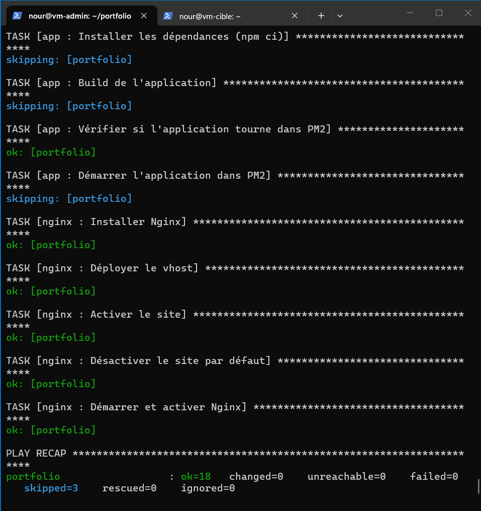
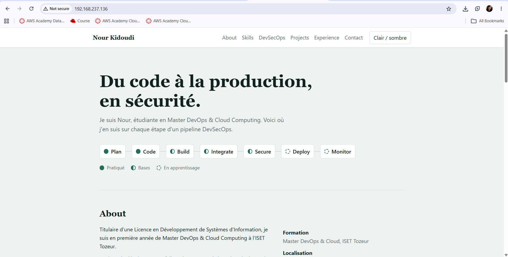
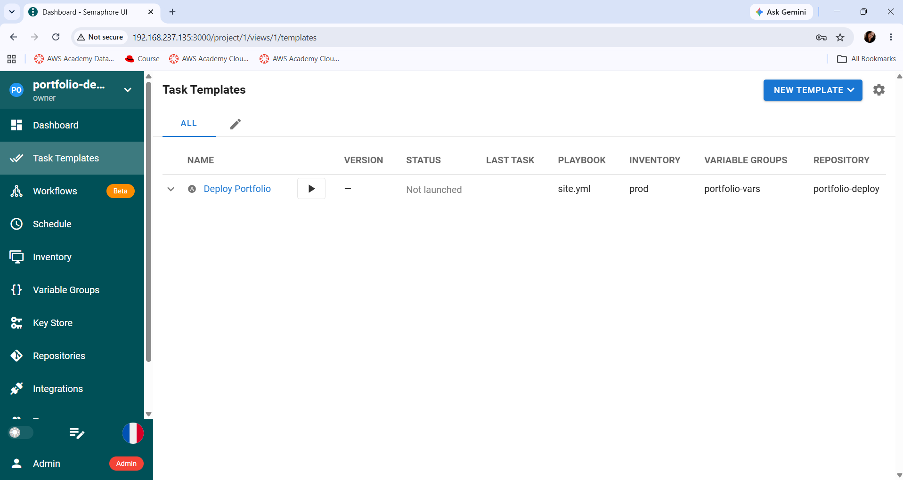
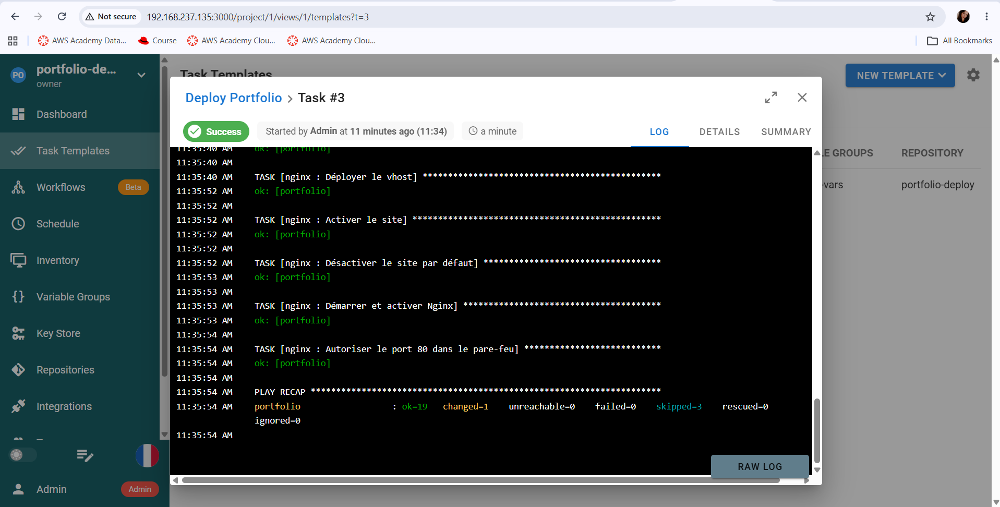

# TP1 : Déploiement d'un portfolio Next.js avec Ansible et Semaphore UI

Master DevOps & Cloud, ISET Tozeur.

## Architecture
- **vm-admin** (192.168.237.135) : poste de contrôle Ansible et Semaphore UI (Docker, port 3000)
- **vm-cible** (192.168.237.136) : Ubuntu 24.04, Node.js, PM2 (port 3000), Nginx (reverse proxy, port 80)

Flux : Semaphore clone le dépôt Git, exécute Ansible, qui configure le serveur.

## Structure du projet
portfolio-deploy/
├── ansible.cfg
├── inventory/hosts.ini
├── group_vars/all.yml
├── site.yml
├── collections/requirements.yml
├── roles/{common,nodejs,app,nginx}
├── captures/
└── RAPPORT.md

## Rôles
| Rôle | Tâches |
|---|---|
| common | cache apt, git/curl/build-essential, utilisateur deploy |
| nodejs | dépôt NodeSource, Node.js, PM2 |
| app | clone du dépôt, npm ci, build, démarrage PM2, redémarrage par handler si le code change |
| nginx | installation, vhost Jinja2, activation du site, port 80 ouvert, reload par handler |

Toutes les valeurs sont dans `group_vars/all.yml`.

## Validation (partie A)
```bash
ansible-playbook site.yml --syntax-check
ansible-playbook site.yml --check --diff
ansible-playbook site.yml
ansible-playbook site.yml   # 2e run : changed=0
```

- [x] `--syntax-check` OK
- [x] 1re exécution sans erreur
- [x] 2e exécution : changed=0
- [x] Portfolio visible sur http://192.168.237.136




## Industrialisation (partie B : Semaphore UI)
Projet `portfolio-deploy` : clé SSH, dépôt GitHub, inventaire statique, groupe de variables (`server_name`, `app_port`), template « Deploy Portfolio » avec la variable de survey `app_version`.




Après modification d'une page et push, la relance a cloné la nouvelle version, reconstruit l'application et déclenché le handler `Restart app`.

## Rapport
Voir [RAPPORT.md](RAPPORT.md).
